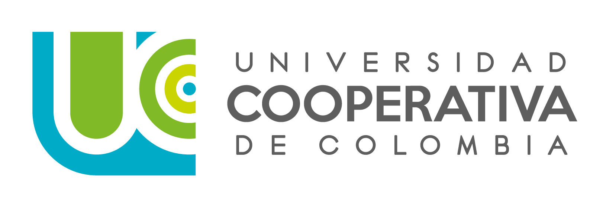

  

# Muestra de Proyectos de Aula

**Universidad Cooperativa de Colombia**  
**Docente:** Rodolfo Ortega  
**Periodo académico:** Segundo semestre de 2026

## Presentación

Esta muestra académica reúne los trabajos realizados por estudiantes de cuarto, séptimo y octavo semestre en cuatro asignaturas relacionadas con la ingeniería de software. Su propósito es dar visibilidad a la aplicación de los conocimientos adquiridos durante el semestre, a través del desarrollo de aplicaciones web Full Stack, el diseño arquitectónico y desarrollo de software, la implementación en Microsoft Azure y la gestión del ciclo de vida del desarrollo de software.

La muestra contiene 25 trabajos académicos presentados mediante videos y organizados por asignatura. Algunos sistemas se presentan en más de una asignatura, con un enfoque académico diferente.

## Asignaturas

| Asignatura | Semestre curricular | Proyectos |
| --- | --- | ---: |
| Electiva III | Séptimo | 8 |
| Arquitecturas de Software y Computacional | Cuarto | 6 |
| Implementación y Mantenimiento de Software | Séptimo | 6 |
| Metodología de Desarrollo de Software Colaborativo | Octavo | 5 |
| **Total** | | **25** |

## Electiva III

**Semestre curricular:** Séptimo semestre.

**Enfoque académico:** Desarrollo de aplicaciones web Full Stack.

### GCEE – Gestión y Centralización de Información de Egresados

Plataforma web para gestionar y centralizar la información de los egresados de la Facultad de Ingeniería, analizar indicadores de empleabilidad y generar reportes que apoyen los procesos de acreditación institucional.

**Estudiantes:**

- Brandon Donovan Benavides Moreno
- Esteban David Idárraga Navarro

### MusicCam

Plataforma digital de entretenimiento musical que conecta artistas y espectadores mediante eventos virtuales, transmisiones en vivo, compra de entradas y gestión de contenidos audiovisuales.

**Estudiantes:**

- Juan David Machado Caicedo
- Rolleiro Betancur Moreno

### Numi

Plataforma educativa orientada a reducir la brecha digital en Medellín mediante una aplicación móvil y paneles web que facilitan el acceso a contenidos educativos, las actividades interactivas y el seguimiento del aprendizaje.

**Estudiantes:**

- Luis Miguel Muñoz Rendón
- Alexander Mejía Ospina
- Santiago Mayorga Hueso
- Santiago Stiven Rodríguez Jiménez

### Recon Facial

Prototipo de apoyo al control de acceso universitario mediante reconocimiento facial, compuesto por una plataforma web de gestión institucional y un dispositivo experimental de identificación biométrica.

**Estudiantes:**

- Juan David Buitrago Ramírez

### RENTIO

Plataforma de gestión inmobiliaria que facilita la publicación de propiedades, las solicitudes de arrendamiento, la programación de visitas y la administración de contratos, incorporando un asistente de inteligencia artificial.

**Estudiantes:**

- Mateo Bedoya Ruiz
- Yeferson Steven Gutiérrez Rincón

### RescateMed

Plataforma que conecta ciudadanos, rescatistas y organizaciones para reportar animales en situación de vulnerabilidad en Medellín, gestionar rescates y facilitar hogares temporales y procesos de adopción.

**Estudiantes:**

- Ismael Segundo Cuello Hernández

### SITP-UCC – Sistema de Trazabilidad de Proyectos de Investigación Formativa

Plataforma para la gestión y seguimiento de proyectos de investigación formativa, que facilita la administración de objetivos, entregables y evidencias, promoviendo la colaboración entre estudiantes, docentes, asesores y jurados.

**Estudiantes:**

- Miguel Ángel Yánez Vargas
- Andrés Felipe Vargas Fierro

### XPAND

Plataforma de turismo gamificado que promueve la exploración cultural y turística de la Comuna 10 de Medellín mediante recorridos interactivos, retos, insignias y recompensas digitales.

**Estudiantes:**

- Daniela Bravo Basante

## Arquitecturas de Software y Computacional

**Semestre curricular:** Cuarto semestre.

**Enfoque académico:** Análisis, metodología, diseño arquitectónico y desarrollo de software.

### Sinu Control

Sistema de gestión de restaurantes que integra pedidos por mesa, operaciones de cocina e inventario por lotes, priorizando el consumo de productos próximos a vencer. Incluye alertas, reportes de ventas y control de caja.

**Estudiantes:**

- Erick Alexander Agudelo Jordan
- Mateo Mantilla Ramos

### Sistema Contable AG Services

Plataforma web para centralizar procesos contables y financieros mediante la gestión de ventas, gastos, inventarios, cuentas y reportes, facilitando el control de las operaciones empresariales.

**Estudiantes:**

- Diego Alejandro Fuentes Ortiz
- Jeinz Anderson Diaz Ortega

### AgroGestion

Plataforma para la gestión y trazabilidad de labores agrícolas en cultivos de café y plátano. Permite administrar fincas, lotes, insumos y cosechas, incorporando la consulta de información mediante códigos QR.

**Estudiantes:**

- Juan Felipe Gómez Vélez
- Jerónimo Gómez Vélez

### ConectaResto

Sistema web de gestión de restaurantes que integra la administración de mesas, productos y pedidos mediante códigos QR, coordinando la atención al cliente, la preparación en cocina y el registro simulado de pagos.

**Estudiantes:**

- Enrique Alfonso
- Eric Camacho

### FilaCero

Plataforma de gestión de turnos presenciales que permite reservar citas, organizar filas, gestionar la atención de usuarios y realizar seguimiento a garantías y reclamaciones mediante paneles administrativos y operativos.

**Estudiantes:**

- Elkin Augusto Amador Padilla
- Angel Andres Reina Ospina

### MUGLY

Plataforma de comercio electrónico especializada en la venta de tazas, que integra catálogo de productos, carrito de compras, pedidos, inventario, clientes y envíos, con un panel administrativo para gestionar las operaciones del negocio.

**Estudiantes:**

- Assael Jesus Zapata Carvajal
- Pedro Julio Diaz Ponguta

## Implementación y Mantenimiento de Software

**Semestre curricular:** Séptimo semestre.

**Enfoque académico:** Preparación de infraestructura, configuración y despliegue de aplicaciones en Microsoft Azure.

### MusicCam

Sustentación del proceso de implementación de MusicCam en Microsoft Azure, con énfasis en la preparación del entorno, la configuración de los servicios y la puesta en funcionamiento de la plataforma web.

**Estudiantes:**

- Rolleiro Betancur Moreno
- Juan David Machado

### Origen – Plataforma web para la integración de estudiantes foráneos

Sustentación del proceso de implementación de Origen en Microsoft Azure, enfocada en la preparación de la infraestructura, la configuración de la aplicación y su despliegue en la nube.

**Estudiantes:**

- Santiago Barrera Castro
- Cristian Vargas Garcia

### Numi – Panel docente

Sustentación de la implementación del panel docente de Numi en Microsoft Azure, centrada en la configuración del entorno, el despliegue de la interfaz web y su integración con los servicios de la aplicación.

**Estudiantes:**

- Luis Miguel Muñoz Rendón
- Santiago Mayorga Hueso

### Numi – Panel administrativo

Sustentación de la implementación del panel administrativo de Numi en Microsoft Azure, con énfasis en la preparación del entorno, la configuración de servicios y el despliegue del componente administrativo.

**Estudiantes:**

- Alexander Mejía Ospina
- Santiago Rodríguez Jiménez

### SITP-UCC – Sistema de Trazabilidad de Proyectos de Investigación Formativa

Sustentación del proceso de implementación de SITP-UCC en Microsoft Azure, orientada a la preparación de la infraestructura, la configuración de los componentes del sistema y su despliegue en la nube.

**Estudiantes:**

- Miguel Angel Yanez Vargas
- Andrés Felipe Vargas Fierro

### Recon Facial

Sustentación de la implementación de Recon Facial en Microsoft Azure, enfocada en la preparación del entorno, la configuración de los servicios web y el despliegue de la plataforma de gestión.

**Estudiantes:**

- Juan David Buitrago Ramírez
- Luisa Fernanda Moreno

## Metodología de Desarrollo de Software Colaborativo

**Semestre curricular:** Octavo semestre.

**Enfoque académico:** Planificación, gestión, seguimiento y documentación del ciclo de vida del desarrollo de software.

### Origen – Plataforma web para la integración de estudiantes foráneos

Documentación y gestión metodológica de una plataforma de acompañamiento, bienestar e integración de estudiantes foráneos de la UCC. El informe aborda requisitos, planificación Scrum, diseño, seguimiento y organización de evidencias del ciclo de vida del proyecto.

**Estudiantes:**

- Emanuel Navarro Tarras
- Cristian David Vargas García
- Santiago Barrera Castro

### CyberGuard

Gestión y documentación del ciclo de vida de un sistema de ciberseguridad orientado a detectar credenciales expuestas en repositorios de código. Integra la planificación Scrum, la trazabilidad de actividades en Jira, GitHub y Google Drive.

**Estudiantes:**

- Juan Osorio Aristizabal
- Mariana Atehortua Grajales
- Jeremy Renteria Serna

### HONEY – Infraestructura de Honeypots

Documentación metodológica de un proyecto de ciberseguridad basado en infraestructura de honeypots y análisis automatizado de amenazas. Comprende la gestión de requisitos, planificación, seguimiento de actividades, control de riesgos y evidencias del proyecto.

**Estudiantes:**

- Fabio Hams Valois Marín

### AulaFácil

Gestión y documentación del ciclo de vida de una plataforma para la reserva de aulas de estudio de la biblioteca universitaria. Incluye procedimientos de análisis, planificación, organización de tareas, control de versiones y seguimiento mediante Jira, GitHub y Google Drive.

**Estudiantes:**

- Yeferson Gutierrez Rincon

### SIGEA

Documentación y planificación metodológica de un sistema de gestión documental para procesos de acreditación académica. Comprende el análisis de requisitos, organización del trabajo, trazabilidad, diseño y procedimientos de validación y mantenimiento.

**Estudiantes:**

- Andrés Girón Palomeque

## Reconocimiento académico

Los trabajos se presentan con fines académicos y se atribuyen a los estudiantes identificados en cada proyecto, bajo la orientación del docente Rodolfo Ortega. Este repositorio reúne la muestra de los proyectos; no contiene necesariamente el código fuente de cada sistema ni implica una licencia de uso sobre los trabajos estudiantiles.
